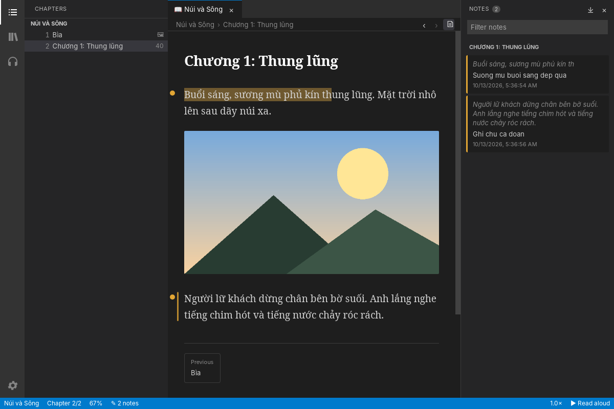

# Marginalia

*Marginalia* are the notes readers write in the margins of a book.

An open-source desktop ebook reader for **EPUB** and **MOBI / PRC / AZW**
files that can **read your books aloud** with open-source neural
text-to-speech. Voice models are downloaded on demand, so nothing big ships
with the app.



> **About this project.** Marginalia is built for its owner's own needs: a
> reader that opens the formats they use and can read to them. It is not
> aimed at any particular audience, market, or business goal. It is shared
> openly (MIT) in case it is useful to someone else, but features and
> priorities follow what the owner needs.

## Status

Early stage. What works today:

| Area | Status |
| --- | --- |
| EPUB 2 / 3 | ✅ metadata, spine order, chapter titles from the TOC |
| MOBI / PRC / AZW | ✅ uncompressed, PalmDOC and HUFF/CDIC compression, EXTH metadata, UTF-8 and CP1252 |
| Plain PalmDOC (`.pdb`, old `.prc`) | ✅ plain-text and HTML content |
| DRM-protected books | ❌ refused with a clear error (DRM-free books only) |
| TTS: Piper neural voices | ✅ catalog of 100+ voices in ~40 languages, downloaded on demand with MD5 checks |
| TTS: eSpeak NG fallback | ✅ uses a system `espeak-ng` when Piper is unavailable |
| Images | ✅ inline pictures (EPUB ``/SVG, MOBI `recindex`) and covers |
| Languages | ✅ Vietnamese and Chinese (Simplified/Traditional) fonts; GBK/Big5/UTF-16 books; Piper voices for vi, zh and ~40 more |
| Playback | ✅ gapless playback while the next sentence is synthesized, or export to WAV |
| Desktop app | ✅ Windows, macOS, Linux (Tauri). No mobile version is planned. |
| CLI | ✅ `marginalia` command for scripting and terminals |

## Desktop app

A VS Code-style window: chapters on the left, the book on the right, and a
status bar with the read-aloud controls.

- **Library**: open books (or drop files onto the window); covers and
  reading progress are remembered.
- **Reader**: dark / light / sepia themes, font, size, spacing and column
  width; reopens where you stopped.
- **Read aloud**: press <kbd>Space</kbd> or double-click a sentence; the
  sentence being spoken is highlighted and followed, across chapters.
- **Voices**: install the Piper engine and download voices with progress
  bars; choose a default voice or let it match the book's language.

Shortcuts: <kbd>Space</kbd> play/pause, <kbd>←</kbd>/<kbd>→</kbd> chapters,
<kbd>Ctrl</kbd>+<kbd>B</kbd> sidebar, <kbd>Ctrl</kbd>+<kbd>O</kbd> open,
<kbd>Ctrl</kbd>+<kbd>+</kbd>/<kbd>-</kbd> font size, <kbd>Esc</kbd> stop.

### Build it

You need a [Rust toolchain](https://rustup.rs) (1.82+) and the
[Tauri prerequisites](https://tauri.app/start/prerequisites/) for your OS
(on Linux: `libwebkit2gtk-4.1-dev libgtk-3-dev librsvg2-dev libasound2-dev`).

```sh
cargo run --release -p marginalia-app           # run it
cargo install tauri-cli --version "^2"
cd crates/marginalia-app && cargo tauri build   # installer (.msi/.dmg/.deb/.AppImage)
```

For Chinese books on Linux, install CJK fonts (`fonts-noto-cjk`); Windows and
macOS ship suitable fonts.

## Command line

You need a [Rust toolchain](https://rustup.rs) (1.82+).

```sh
git clone https://github.com/zunnievo94/ZReader
cd Marginalia
cargo install --path crates/marginalia-cli
```

On Linux, audio playback needs the ALSA headers (`sudo apt install
libasound2-dev` / `sudo dnf install alsa-lib-devel`). To build without audio
output (WAV export only), run `cargo install --path crates/marginalia-cli
--no-default-features`.

## Usage

```sh
marginalia info book.epub          # title, authors, language, word count
marginalia toc  book.mobi          # numbered chapter list
marginalia read book.prc -c 3      # print chapter 3 as plain text

marginalia speak book.epub                 # read aloud from chapter 1
marginalia speak book.epub -c 5 --speed 1.2
marginalia speak book.epub -c 5 --chapters 1 --out chapter5.wav
marginalia say "Testing a voice" --voice en_GB-alan-medium
```

The first time you use `speak` or `say`, Marginalia picks a voice for the
book's language, asks before downloading it (~20–100 MB), and asks before
downloading the Piper engine (~25 MB). Add `--yes` to skip the questions.

### Managing voices

```sh
marginalia voices list --lang en         # browse the catalog
marginalia voices download en_US-amy-medium
marginalia voices list --installed
marginalia voices remove en_US-amy-medium
marginalia engine install                # fetch the Piper runtime up front
marginalia engine status                 # what is installed and where
```

Engines can be chosen with `--engine piper|espeak|auto` (default `auto`:
Piper, falling back to eSpeak NG).

Downloads are stored in the platform data directory
(`~/.local/share/marginalia` on Linux, `~/Library/Application
Support/org.marginalia.Marginalia` on macOS, `%APPDATA%\marginalia\Marginalia\data` on
Windows). Set `MARGINALIA_DATA_DIR` to use another location, or `MARGINALIA_PIPER`
to point at your own Piper build.

## How it works

```
crates/
  marginalia-core   Book model + parsers. EPUB via the `epub` crate; MOBI/PRC
                 (Palm database, PalmDOC LZ77, HUFF/CDIC, EXTH) implemented
                 here. HTML is converted to clean paragraphs; text is split
                 into sentences for speech.
  marginalia-tts    Voice catalog + downloader (Hugging Face rhasspy/piper-voices,
                 pinned to v1.0.0, MD5-verified), Piper runtime installer and
                 driver, eSpeak NG driver, WAV writer, audio player (rodio).
  marginalia-cli    The `marginalia` command.
  marginalia-app    Desktop app: Tauri backend (src/) + plain HTML/CSS/JS UI (ui/),
                 no Node or bundler needed.
```

Speech is produced one sentence at a time on a worker thread. Piper is kept
running as a single child process, so the model loads once per session, and
audio plays while the next sentence is being synthesized.

## Why Rust (and not Go)

Both were considered; Rust was chosen because:

1. **App UI options.** [Tauri 2](https://tauri.app) gives one Rust codebase
   for Windows, macOS, Linux, **Android and iOS**, with a small binary. Rust
   also has native toolkits (Slint, egui, iced). Go's desktop and mobile UI
   story (Fyne, Wails, gomobile) is thinner, especially on mobile.
2. **On-device TTS.** Neural TTS runs on ONNX Runtime and eSpeak NG, both
   C/C++ libraries. Rust links them with zero-cost FFI (`ort`, `sherpa-rs`);
   Go needs cgo, which complicates cross-compiling and mobile builds.
3. **Real-time audio.** No garbage collector means no GC pauses in the
   playback path, and `cpal`/`rodio` cover every desktop and mobile platform.
4. **Ebook parsing.** Mature crates exist (`epub`, `zip`, `quick-xml`,
   `encoding_rs`), and Rust's memory safety matters when parsing untrusted
   files from the internet.

Go would build faster and is simpler to learn, which suits a backend or a
pure CLI better than a cross-platform reading app with audio.

## Roadmap

- [x] Desktop app (Tauri 2) with library, reader, sentence highlighting
- [x] Remember reading position and resume reading aloud
- [ ] Search inside a book; bookmarks and notes
- [ ] Run Piper in-process (ONNX Runtime via `sherpa-rs`/`ort`) instead of a
      child process; also add Kokoro voices
- [ ] Full KF8 (AZW3) structure: chapter splitting from the NCX index
- [x] Images and covers
- [ ] Basic book styling (bold/italic, tables)
- [ ] FB2, TXT and (maybe) PDF text

## Licenses

Marginalia is MIT licensed (see [LICENSE](LICENSE)). Downloaded components keep
their own licenses: the [Piper](https://github.com/rhasspy/piper) engine is
MIT, each [Piper voice](https://huggingface.co/rhasspy/piper-voices) has a
`MODEL_CARD` with its dataset license, and
[eSpeak NG](https://github.com/espeak-ng/espeak-ng) (GPL-3.0) is only run as
a separate program, never linked.
