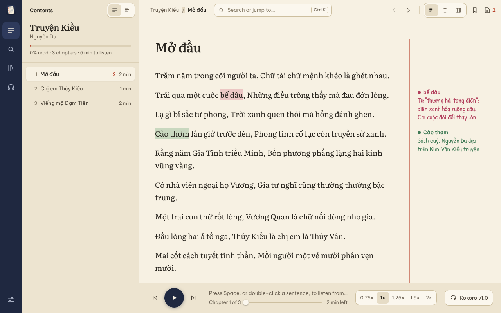
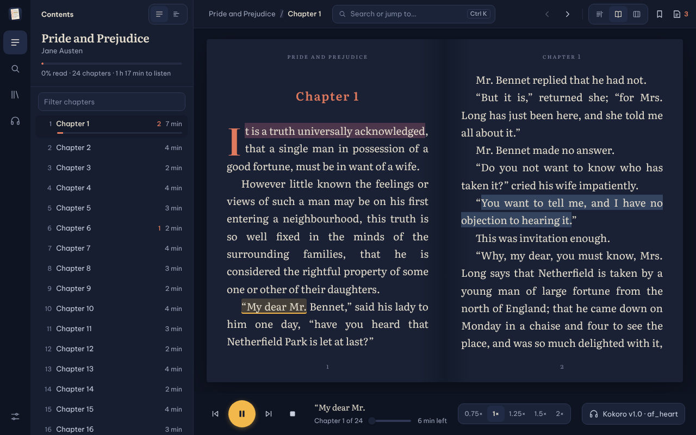
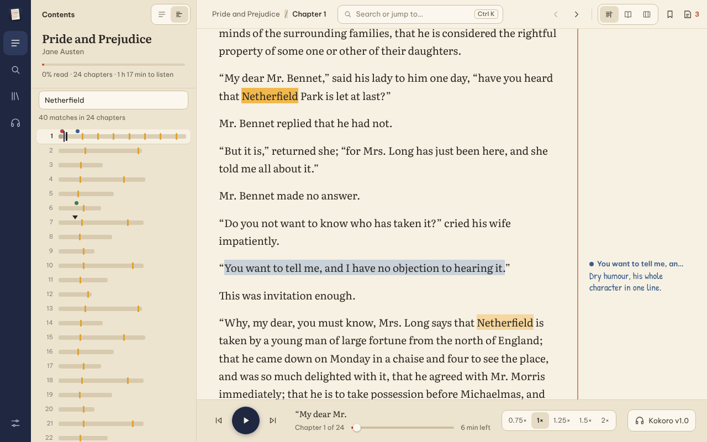

<p align="center"></p>

# Marginalia

*Marginalia* are the notes readers write in the margins of a book. The logo
is a page whose margin note is a sound wave: a book you can annotate and
listen to.

An open-source desktop ebook reader for **EPUB**, **MOBI / PRC / AZW**,
**FB2**, **TXT**, **Markdown** and **PDF** (text) files that can **read your books aloud** with open-source neural
text-to-speech. Voice models are downloaded on demand, so nothing big ships
with the app.



| Book layout, reading aloud at night | Book map with search matches |
| --- | --- |
|  |  |

> **About this project.** Marginalia is built for its owner's own needs: a
> reader that opens the formats they use and can read to them. It is not
> aimed at any particular audience, market, or business goal. It is shared
> openly (GPL-3.0-or-later) in case it is useful to someone else, but features and
> priorities follow what the owner needs.

## Download

| System | Installer |
| --- | --- |
| **Windows** 10/11 (64-bit) | [Marginalia-windows-x64-setup.exe](https://github.com/zunnievo94/marginalia/releases/latest/download/Marginalia-windows-x64-setup.exe) · [.msi](https://github.com/zunnievo94/marginalia/releases/latest/download/Marginalia-windows-x64.msi) |
| **macOS** Apple Silicon (M1–M4) | [Marginalia-macos-arm64.dmg](https://github.com/zunnievo94/marginalia/releases/latest/download/Marginalia-macos-arm64.dmg) |
| **macOS** Intel | [Marginalia-macos-x64.dmg](https://github.com/zunnievo94/marginalia/releases/latest/download/Marginalia-macos-x64.dmg) |
| **Linux** (any distro) | [Marginalia-linux-x86_64.AppImage](https://github.com/zunnievo94/marginalia/releases/latest/download/Marginalia-linux-x86_64.AppImage) · [.deb](https://github.com/zunnievo94/marginalia/releases/latest/download/Marginalia-linux-amd64.deb) |
| Command line | [Linux](https://github.com/zunnievo94/marginalia/releases/latest/download/marginalia-cli-x86_64-unknown-linux-gnu.tar.gz) · [Windows](https://github.com/zunnievo94/marginalia/releases/latest/download/marginalia-cli-x86_64-pc-windows-msvc.zip) · [macOS Apple Silicon](https://github.com/zunnievo94/marginalia/releases/latest/download/marginalia-cli-aarch64-apple-darwin.tar.gz) · [macOS Intel](https://github.com/zunnievo94/marginalia/releases/latest/download/marginalia-cli-x86_64-apple-darwin.tar.gz) |

These links always point to the [latest release](https://github.com/zunnievo94/marginalia/releases/latest).
The builds are not code-signed yet:

- **Windows**: if SmartScreen warns, click *More info → Run anyway*.
- **macOS**: if it says the app is damaged or from an unidentified developer,
  move it to Applications and run `xattr -cr /Applications/Marginalia.app`.
- **Linux AppImage**: `chmod +x Marginalia-linux-x86_64.AppImage` and run it.

## Status

Early stage. What works today:

| Area | Status |
| --- | --- |
| EPUB 2 / 3 | ✅ metadata, spine order, chapter titles from the TOC |
| MOBI / PRC / AZW | ✅ uncompressed, PalmDOC and HUFF/CDIC compression, EXTH metadata, UTF-8 and CP1252 |
| KF8 / AZW3 | ✅ chapters rebuilt from the skeleton/fragment indexes and titled from the NCX; `kindle:embed` images; hybrid MOBI+KF8 files |
| Plain PalmDOC (`.pdb`, old `.prc`) | ✅ plain-text and HTML content |
| FB2 (`.fb2`, `.fb2.zip`, `.fbz`) | ✅ metadata, nested sections as chapters, emphasis, poems and epigraphs, embedded images and cover, notes |
| TXT | ✅ UTF-8, UTF-16 and legacy encodings (GBK, Big5, windows-125x…) detected; chapters split at headings such as “Chương 1”, “第一章”, “Chapter 1” |
| Markdown | ✅ one chapter per top heading; bold, italic, tables |
| PDF | ✅ the text layer, reflowed into paragraphs, 10 pages per chapter; scanned PDFs (pictures of pages) cannot be read |
| Styling | ✅ bold, italic, underline, strikethrough, super/subscript, code, headings, block quotes and tables |
| DRM-protected books | ❌ refused with a clear error (DRM-free books only) |
| Text-to-speech | ✅ runs inside the app with [sherpa-onnx](https://github.com/k2-fsa/sherpa-onnx): 89 Piper voices (~40 languages), Kokoro (natural English and Mandarin), Supertonic 3 (31 languages), [VieNeu-TTS](https://github.com/pnnbao97/VieNeu-TTS) v3 Turbo and Nano (natural Vietnamese, no Python needed); models downloaded on demand |
| TTS fallback | ✅ a system `espeak-ng` when no voice model is installed |
| Images | ✅ inline pictures (EPUB ``/SVG, MOBI `recindex`) and covers |
| Languages | ✅ Vietnamese and Chinese (Simplified/Traditional) fonts; GBK/Big5/UTF-16 books; voices for vi, zh and ~40 more |
| Search & bookmarks | ✅ whole-book search ignoring case and accents; bookmarks |
| Playback | ✅ gapless playback while the next sentence is synthesized, or export to WAV |
| Notes | ✅ on passages or paragraphs, colors, notes panel, Markdown export |
| Desktop app | ✅ Windows, macOS, Linux (Tauri). No mobile version is planned. |
| CLI | ✅ `marginalia` command for scripting and terminals |

## Desktop app

Chapters on the left, the book on the right, in an ink-and-paper look:
**Paper**, **Night** and **Sepia** themes, Literata for books and Be Vietnam
Pro for the interface (both bundled, with full Vietnamese support; Chinese
uses the system's CJK fonts). Three layouts, switched from the toolbar:

- **Margin** (default): notes are written in the margin beside the passage
  they annotate, along a red margin rule, in a handwriting font if you like.
- **Book**: a two-page spread with running heads, page numbers and a drop
  cap; <kbd>←</kbd>/<kbd>→</kbd>, <kbd>PgUp</kbd>/<kbd>PgDn</kbd> or the
  mouse wheel turn pages, across chapters.
- **Workbench**: VS Code style, with a tab per open book, the notes panel
  and a status bar.

- **Library**: open books (or drop files onto the window); covers and
  reading progress are remembered.
- **Contents**: each chapter shows how long it takes to listen to and how
  much of it you have read. The **book map** draws the whole book, one bar
  per chapter to scale, with search matches, notes, bookmarks and your
  position on it; click anywhere to jump there.
- **Read aloud**: press <kbd>Space</kbd> or double-click a sentence; the
  sentence being spoken is highlighted and followed, across chapters and
  pages. The player under the text shows the sentence, the place in the
  chapter and the time left, steps sentence by sentence and changes speed.
- **Notes**: select any passage (even across paragraphs) to **Add note**,
  **Highlight**, **Read from here** or **Copy**, or click the **+** left of a
  paragraph to annotate all of it. Notes come in four colors, are listed in
  a panel on the right (<kbd>Ctrl</kbd>+<kbd>Shift</kbd>+<kbd>M</kbd>) and can
  be exported to Markdown.
- **Search and jump**: <kbd>Ctrl</kbd>+<kbd>K</kbd> jumps to a chapter, runs
  a command (layout, theme…) or searches; <kbd>Ctrl</kbd>+<kbd>F</kbd>
  searches the whole book, ignoring case and accents (“thung lung” finds
  “thung lũng”); <kbd>Enter</kbd>/<kbd>F3</kbd> steps through the matches.
- **Replace**: rename a character or fix how a word is read, everywhere
  in a book or in every book (“Trương Cao Thiên” → “Trương Cao Trời”,
  “TP.HCM” → “thành phố Hồ Chí Minh”). Select a word and choose
  **Replace…**, or open the Replace tab next to the notes. Rules change
  what is shown, searched and read aloud, never the book file; longer
  phrases win over shorter ones, with options for whole words and case.
  Rule lists can be imported and exported as text files, one
  `find=replace` per line.
- **Names in this book**: the names a book uses most, grouped by their
  first word, so a character translated several ways (common in
  machine-translated novels) shows its variants side by side; one click
  maps a rare variant onto the usual one.
- **Bookmarks**: <kbd>Ctrl</kbd>+<kbd>D</kbd> (or the ribbon button) marks the
  paragraph you are reading; bookmarks are listed next to the notes.
- **Voices**: pick a voice per language (Vietnamese books keep a Vietnamese
  voice, English books an English one), choose a speaker, listen to a sample,
  and download or remove models with progress bars.

Shortcuts: <kbd>Ctrl</kbd>+<kbd>K</kbd> search or jump, <kbd>Space</kbd> play/pause,
<kbd>←</kbd>/<kbd>→</kbd> chapters (pages in the book layout),
<kbd>Ctrl</kbd>+<kbd>F</kbd> search, <kbd>Ctrl</kbd>+<kbd>D</kbd> bookmark,
<kbd>Ctrl</kbd>+<kbd>B</kbd> sidebar, <kbd>Ctrl</kbd>+<kbd>O</kbd> open,
<kbd>Ctrl</kbd>+<kbd>+</kbd>/<kbd>-</kbd> font size, <kbd>Esc</kbd> stop.

### Build it

You need a [Rust toolchain](https://rustup.rs) (1.82+) and the
[Tauri prerequisites](https://tauri.app/start/prerequisites/) for your OS
(on Linux: `libwebkit2gtk-4.1-dev libgtk-3-dev librsvg2-dev libasound2-dev`).

```sh
cargo run --release -p marginalia-app           # run it
cargo install tauri-cli --version "^2"
cd crates/marginalia-app && cargo tauri build   # installer (.msi/.dmg/.deb/.AppImage)
```

For Chinese books on Linux, install CJK fonts (`fonts-noto-cjk`); Windows and
macOS ship suitable fonts.

## Command line

You need a [Rust toolchain](https://rustup.rs) (1.82+).

```sh
git clone https://github.com/zunnievo94/Marginalia
cd Marginalia
cargo install --path crates/marginalia-cli
```

On Linux, audio playback needs the ALSA headers (`sudo apt install
libasound2-dev` / `sudo dnf install alsa-lib-devel`). To build without audio
output (WAV export only), run `cargo install --path crates/marginalia-cli
--no-default-features`.

## Usage

```sh
marginalia info book.epub          # title, authors, language, word count
marginalia toc  book.mobi          # numbered chapter list
marginalia read book.prc -c 3      # print chapter 3 as plain text

marginalia speak book.epub                 # read aloud from chapter 1
marginalia speak book.epub -c 5 --speed 1.2
marginalia speak book.epub -c 5 --chapters 1 --out chapter5.wav
marginalia say "Xin chào" --lang vi
marginalia say "Xin chào" --voice vieneu-tts-v3-turbo --speaker "Ngọc Huyền"
marginalia say "Hello there" --voice kokoro-multi-lang-v1_0 --speaker bf_emma
```

The first time you use `speak` or `say`, Marginalia picks a voice model for
the book's language and asks before downloading it (30–350 MB). Add `--yes`
to skip the question.

### Managing voices

```sh
marginalia voices list --lang vi         # models for a language, best first
marginalia voices show kokoro-multi-lang-v1_0   # details and speaker names
marginalia voices download vits-piper-vi_VN-vais1000-medium
marginalia voices list --installed
marginalia voices remove vits-piper-vi_VN-vais1000-medium
marginalia status                        # what is installed and where
```

Engines can be chosen with `--engine neural|espeak|auto` (default `auto`:
neural voices, falling back to eSpeak NG).

| Model | Languages | Size | Notes |
| --- | --- | --- | --- |
| Piper (`vits-piper-*`) | one each, ~40 languages | 30–130 MB | small and fast; default for **Vietnamese** (`vi_VN-vais1000-medium`) |
| Kokoro v1.0 | English (US/UK), Mandarin | 350 MB | most natural English/Chinese; needs a reasonably fast CPU |
| Supertonic 3 | 31 languages incl. Vietnamese, Korean, Japanese | 129 MB | 44.1 kHz, 10 speakers; in Vietnamese it sometimes repeats or skips words |
| VieNeu-TTS v3 Turbo | Vietnamese (with English words) | 583 MB | the most natural Vietnamese; 48 kHz, 25 voices; needs a fast CPU (about real time on 4 cores) |
| VieNeu-TTS v3 Nano | Vietnamese | 347 MB | natural Vietnamese for slower CPUs; 24 kHz, 11 voices |

Speed changes nothing for VieNeu Turbo: it is an autoregressive model with
no speed control.

Downloads are stored in the platform data directory
(`~/.local/share/marginalia` on Linux, `~/Library/Application
Support/org.marginalia.Marginalia` on macOS, `%APPDATA%\marginalia\Marginalia\data` on
Windows). Set `MARGINALIA_DATA_DIR` to use another location.

## How it works

```
crates/
  marginalia-core   Book model + parsers. EPUB via the `epub` crate; MOBI/PRC
                    (Palm database, PalmDOC LZ77, HUFF/CDIC, EXTH) and KF8
                    (INDX/TAGX indexes, skeleton/fragment, NCX) implemented
                    here, as are FB2, TXT and Markdown; PDF text via
                    `pdf-extract`. HTML becomes paragraphs (with their
                    bold/italic spans), images and tables; text is split
                    into sentences for speech; accent-insensitive search.
  marginalia-tts    Voice model catalog + downloader (sherpa-onnx GitHub
                    releases, Hugging Face), in-process synthesis with
                    sherpa-onnx (ONNX Runtime + espeak-ng, statically
                    linked), VieNeu voices through the vieneu-tts crate on the
                    same ONNX Runtime, eSpeak NG fallback, WAV writer, audio
                    player (rodio).
  marginalia-cli    The `marginalia` command.
  marginalia-app    Desktop app: Tauri backend (src/) + plain HTML/CSS/JS UI (ui/),
                 no Node or bundler needed.
```

Speech is produced one sentence at a time on a worker thread: the model is
loaded once per session, and audio plays while the next sentence is being
synthesized.

Voice quality was checked by transcribing generated Vietnamese audio with a
Vietnamese speech-recognition model (sherpa-onnx `zipformer-vi`): Piper
`vais1000` came back word-perfect, Supertonic sometimes repeated or dropped
words, which is why Piper is the Vietnamese default.

VieNeu voices come from [vieneu-tts-rs](https://github.com/zunnievo94/vieneu-tts-rs),
a separate crate so other Rust programs can use them too. The models and
their design are the work of Phạm Nguyễn Ngọc Bảo and VieNeu-TTS; the
crate only re-implements inference. They run without Python: text goes through
[sea-g2p](https://github.com/pnnbao97/sea-g2p) (a Rust crate), the graphs
through the ONNX Runtime that sherpa-onnx already links, and the glue
VieNeu writes in NumPy (embeddings, sampling, the stop and "babble" checks)
is ported to Rust. The port was checked against the Python package: same
phonemes and tokens, identical audio codes for Turbo with sampling turned
off, and the same Nano waveform for the same starting noise (111 dB SNR).
On 8 sentences × 3 takes the speech recognizer found 1.9% word errors for
Turbo and 4.7% for Nano (Python: 3.9% and 2.3%; Piper `vais1000`: 3.9%).
These differences are sampling noise. Piper stays the default download
because it is a tenth of the size and runs on any CPU.

## Why Rust (and not Go)

Both were considered; Rust was chosen because:

1. **App UI options.** [Tauri 2](https://tauri.app) gives one Rust codebase
   for Windows, macOS, Linux, **Android and iOS**, with a small binary. Rust
   also has native toolkits (Slint, egui, iced). Go's desktop and mobile UI
   story (Fyne, Wails, gomobile) is thinner, especially on mobile.
2. **On-device TTS.** Neural TTS runs on ONNX Runtime and eSpeak NG, both
   C/C++ libraries. Rust links them with zero-cost FFI (`ort`, `sherpa-rs`);
   Go needs cgo, which complicates cross-compiling and mobile builds.
3. **Real-time audio.** No garbage collector means no GC pauses in the
   playback path, and `cpal`/`rodio` cover every desktop and mobile platform.
4. **Ebook parsing.** Mature crates exist (`epub`, `zip`, `quick-xml`,
   `encoding_rs`), and Rust's memory safety matters when parsing untrusted
   files from the internet.

Go would build faster and is simpler to learn, which suits a backend or a
pure CLI better than a cross-platform reading app with audio.

## Roadmap

- [x] Desktop app (Tauri 2) with library, reader, sentence highlighting
- [x] Remember reading position and resume reading aloud
- [x] Notes on passages and paragraphs, Markdown export
- [x] Search inside a book; bookmarks
- [x] Voices in-process with sherpa-onnx; Kokoro and Supertonic voices
- [x] Full KF8 (AZW3) structure: chapter splitting from the NCX index
- [x] A more natural Vietnamese voice: VieNeu-TTS v3, without Python
- [x] Images and covers
- [x] Basic book styling (bold/italic, tables)
- [x] FB2, TXT, Markdown and PDF text
- [x] Find and replace words in a book

## Licenses

Copyright © 2026 zunnievo94.

Marginalia is free software: you can redistribute it and/or modify it under
the terms of the [GNU General Public License](LICENSE) as published by the
Free Software Foundation, either version 3 of the License, or (at your
option) any later version. It is distributed in the hope that it will be
useful, but WITHOUT ANY WARRANTY; without even the implied warranty of
MERCHANTABILITY or FITNESS FOR A PARTICULAR PURPOSE. See the license for
details.

The released programs include third-party components, among them [eSpeak
NG](https://github.com/espeak-ng/espeak-ng) (GPL-3.0-or-later, linked
through sherpa-onnx), the [`epub`](https://github.com/danigm/epub-rs) crate
(GPL-3.0), sherpa-onnx (Apache-2.0), ONNX Runtime (MIT), and code ported
from [VieNeu-TTS](https://github.com/pnnbao97/VieNeu-TTS) and
[sea-g2p](https://github.com/pnnbao97/sea-g2p) (Apache-2.0); all are
compatible with the GPL-3.0. See [THIRD_PARTY_NOTICES.md](THIRD_PARTY_NOTICES.md).

Voice models are downloaded separately and keep their own licenses: Piper
voices list theirs in the bundled `MODEL_CARD`, Kokoro is Apache-2.0, and
Supertonic 3 is MIT (code) with OpenRAIL-M weights, and VieNeu-TTS (models,
codec and sea-g2p dictionary) is Apache-2.0.
